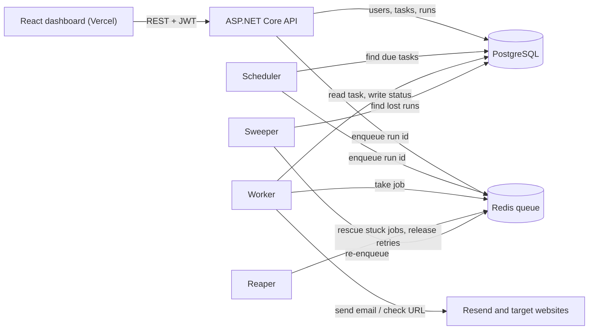
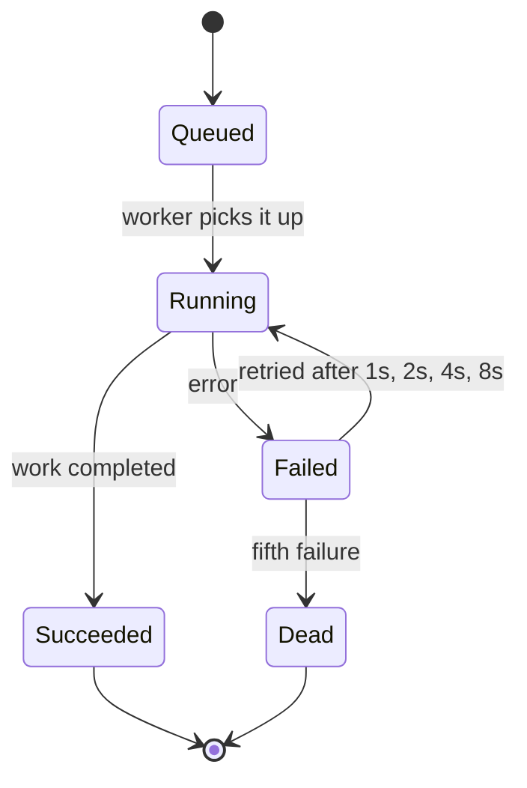

# TaskHub

> Schedule a task once. A reliable job queue runs it on time, retries it when it fails, and never loses it.

**Live demo:** (https://task-hub-nu-green.vercel.app)

> The demo runs on free hosting, so the server sleeps when idle. The first visit can take up to a minute to wake it.

## What it does

- Create tasks that **send an email** or **check that a website is up**
- Run a task **once, right now**, or on a **cron schedule** (times are UTC)
- **Run now, pause and resume** from the dashboard
- Live run history with colored statuses: `Queued`, `Running`, `Succeeded`, `Failed`, `Dead`, with attempts and error messages
- Accounts with JWT login. Every user sees only their own tasks.

## Why I built it

The interesting part is not the UI. It is the engine underneath: a **job queue built from scratch on Redis** that survives crashes, retries failures with exponential backoff, parks hopeless jobs in a dead-letter list, and never runs a job's side effects twice. I wanted to understand the problems that libraries like Hangfire, BullMQ and Sidekiq solve by solving them myself.

## Architecture



| Component | Job |
|---|---|
| **API** | REST endpoints, login, validation. Stores tasks and runs in PostgreSQL and puts run IDs on the queue. |
| **Scheduler** | Every few seconds, finds tasks whose next run time has passed, creates a run and queues it. |
| **Worker** | Takes a run ID from the queue, loads the task, does the work, records the result. Run several for more throughput. |
| **Reaper** | Returns jobs stuck with a dead worker to the queue and releases retries whose wait is over. |
| **Sweeper** | Re-queues runs that the database says are queued but the queue has forgotten. |
| **PostgreSQL** | The source of truth: users, tasks, run history. |
| **Redis** | Work in flight: the waiting line and its bookkeeping. The queue carries only run IDs. |

## How a run flows

1. The API (or the Scheduler) saves a `Run` row in PostgreSQL with status `Queued` and pushes its ID onto the Redis list `jobs`.
2. A worker atomically moves the ID from `jobs` to `processing` (so it can never be "in nobody's hands") and records the pick-up time.
3. The worker loads the task from PostgreSQL, marks the run `Running`, and performs the work.
4. **Success:** the run becomes `Succeeded` and the job is acknowledged (removed from `processing`).
5. **Failure:** the run becomes `Failed`, the job waits in a sorted set (`delayed`) for 1s, 2s, 4s, 8s, then goes back to `jobs`. After the fifth failure the run becomes `Dead` and the job moves to the `dead` list.



## Reliability: what happens when things go wrong

| What goes wrong | What the system does |
|---|---|
| The work fails (email service down, site returns 500) | Retries with exponential backoff, then dead-letters after 5 attempts |
| A worker crashes mid-job | The job is still on the `processing` shelf. After a 10 second visibility timeout the Reaper puts it back in the queue. |
| The same job runs twice (crash after the work, before the acknowledgment) | An idempotency marker in Redis skips the duplicate, and emails carry an idempotency key so the email provider refuses a second send |
| Two schedulers see the same due task | A compare-and-set update "claims" the task, so only one wins |
| The scheduler was down for a while | Missed runs are skipped, not replayed in a burst |
| Redis forgets its data | The Sweeper finds runs still `Queued` in PostgreSQL that the queue doesn't know about and re-queues them |
| Redis or the database is unreachable for a moment | The background loops log it, wait, and try again instead of crashing |

Delivery is **at-least-once**. Exactly-once is not achievable in general, so jobs are designed to be idempotent.

## Key design decisions

- **A "processing" list instead of a plain pop.** Popping a job and then working on it loses the job if the worker dies. Moving it atomically to a second list keeps it recoverable.
- **PostgreSQL is the source of truth, Redis is the line.** The queue carries only run IDs. Details live in one place, and Redis can lose data without losing history.
- **Schedules live in the database, not Redis,** so they survive restarts.
- **Run status is tracked per execution,** which gives a full audit trail instead of a single "last status" on the task.
- **JWT authentication with ownership checks on every query.** The user ID comes from the verified token, never from the request body, and other users' resources answer 404.
- **The same code runs in two shapes:** separate processes locally, or one process (the API hosts the loops) on free hosting, switched by a setting.

## Tech stack

| Area | Technology |
|---|---|
| Backend | .NET 10, ASP.NET Core minimal APIs, Entity Framework Core |
| Queue | Redis (StackExchange.Redis) |
| Database | PostgreSQL (Npgsql) |
| Scheduling | Cron expressions (Cronos) |
| Auth | JWT bearer tokens, salted password hashing |
| Email | Resend HTTP API |
| Frontend | React, Vite |
| Hosting | Vercel (client), Render (API, Docker), Neon (PostgreSQL) |

## Project structure

```
client/                      React website
  src/
    api/                     all calls to the server
    components/              tables, form, status badge
    pages/                   login and dashboard screens
    utils/                   time formatting, session storage
    styles/
server/                      .NET solution
  TaskHub.Core/              entities and interfaces (no Redis or database code)
  TaskHub.Infrastructure/    Redis queue, EF Core, cron, settings loader, migrations
  TaskHub.Background/        worker, reaper, scheduler and sweeper loops, task handlers
  TaskHub.Api/               REST API and login
  TaskHub.Worker/            runs the worker loop as its own program
  TaskHub.Reaper/            runs the reaper loop as its own program
  TaskHub.Scheduler/         runs the scheduler and sweeper as their own program
  Dockerfile                 image used for hosting the API
.env.example                 every setting, with placeholders
```

## Run it locally

**You need:** .NET 10 SDK, Node.js 20 or newer, and Docker.

1. Start Redis and PostgreSQL:

   ```bash
   docker run -d --name taskhub-redis -p 6379:6379 redis:7
   docker run -d --name taskhub-postgres -e POSTGRES_USER=taskhub -e POSTGRES_PASSWORD=taskhub_dev -e POSTGRES_DB=taskhub -p 5433:5432 postgres:16
   ```

2. Create your settings file and fill in the values (the generated secret is explained inside):

   ```bash
   cp .env.example .env
   ```

3. Start the server, each command in its own terminal, from the `server` folder. The tables are created automatically on first start.

   ```bash
   dotnet run --project TaskHub.Api --urls http://localhost:5080
   dotnet run --project TaskHub.Worker
   dotnet run --project TaskHub.Reaper
   dotnet run --project TaskHub.Scheduler
   ```

4. Start the website, from the `client` folder:

   ```bash
   npm install
   npm run dev
   ```

5. Open http://localhost:5173, create an account, and create a task.

## Configuration

| Variable | Purpose |
|---|---|
| `POSTGRES_CONNECTION` | PostgreSQL address (a `postgresql://` URL or `Host=...;` format) |
| `REDIS_CONNECTION` | Redis address (`host:port` or a `redis://` URL) |
| `JWT_SECRET` | At least 32 random characters, used to sign login tokens |
| `RESEND_API_KEY` | Needed by the worker to send emails |
| `EMAIL_FROM` | Sender address for emails |
| `UI_ORIGIN` | Website address(es) allowed to call the API (comma separated) |
| `RUN_BACKGROUND_SERVICES` | `true` runs the worker, reaper, scheduler and sweeper inside the API |
| `AUTO_MIGRATE` | `false` stops tables from being created at startup |
| `PORT` | Port to listen on (set by hosting platforms) |
| `VITE_API_URL` | (client) address of the API |

Secrets live in a git-ignored `.env` file locally and in the hosting platform's environment settings in production.

## API

| Method and path | Auth | What it does |
|---|---|---|
| `GET /health` | no | liveness check |
| `POST /auth/register` | no | create an account |
| `POST /auth/login` | no | returns a JWT |
| `GET /tasks` | yes | list my tasks |
| `POST /tasks` | yes | create a task (one-off, or scheduled with `cron`) |
| `POST /tasks/{id}/run` | yes | run a task now |
| `POST /tasks/{id}/pause` | yes | pause a scheduled task |
| `POST /tasks/{id}/resume` | yes | resume a paused task |
| `GET /runs` | yes | my 50 most recent runs |

```bash
# register, log in, and create a website check that runs every 5 minutes
curl -X POST http://localhost:5080/auth/register -H "Content-Type: application/json" \
  -d '{"email":"you@example.com","password":"a-long-password"}'

TOKEN=$(curl -s -X POST http://localhost:5080/auth/login -H "Content-Type: application/json" \
  -d '{"email":"you@example.com","password":"a-long-password"}' | sed -E 's/.*"token":"([^"]+)".*/\1/')

curl -X POST http://localhost:5080/tasks -H "Authorization: Bearer $TOKEN" -H "Content-Type: application/json" \
  -d '{"name":"Monitor example.com","type":"CheckUrl","target":"https://example.com","cron":"*/5 * * * *"}'
```

## Deployment

The demo runs entirely on free tiers:

- **Client:** Vercel (root directory `client`)
- **API plus background loops:** one Render web service built from `server/Dockerfile`, with `RUN_BACKGROUND_SERVICES=true`
- **Queue:** Render Key Value (Redis)
- **Database:** Neon PostgreSQL

Free web services sleep when idle, so scheduled tasks only run while the server is awake. Missed runs are skipped on wake-up by design.

## Known limitations and roadmap

- [x] Reliable queue: atomic claim, crash recovery, retries with backoff, dead-letter list
- [x] Idempotent execution and a sweeper for lost runs
- [x] Cron scheduling with duplicate-run protection
- [x] JWT login with per-user ownership checks
- [x] React dashboard with live status
- [x] Free-tier deployment
- [ ] Automated tests (xUnit) and CI with GitHub Actions
- [ ] Docker Compose for one-command local startup
- [ ] Load test with published results
- [ ] Rate limiting on login and registration
- [ ] Restrict outbound requests made by URL checks
- [ ] Pagination, plus edit and delete for tasks
- [ ] Separate transient errors (retry) from permanent ones (fail fast)
- [ ] Refresh tokens and time-zone aware schedules
- [ ] Push updates (SignalR) instead of polling

## Author

Keerthan Poovaiah M M · [LinkedIn: Keerthan-poovaiah](https://linkedin.com/in/keerthan-poovaiah) · [GitHub: Keerthan-poovaiah](https://github.com/Keerthan-poovaiah)
